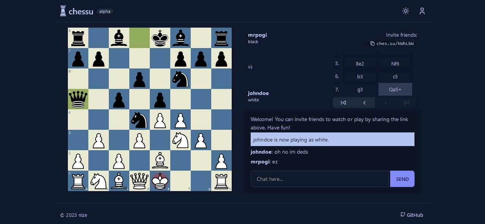

# KnightLink

[](https://github.com/Ashu-1104/knightlink/actions/workflows/ci.yml)

Real-time multiplayer chess in the browser — play friends with an invite link, spectate and chat in live games, and track your stats with an optional account.

<p align="center">
  
</p>

## Features

- **Real-time multiplayer** over WebSockets (Socket.IO), with spectators and in-game chat
- **Time controls and chess clocks** from 1+0 bullet to 15+10 rapid; the server keeps the authoritative clock, applies increments and ends games on time
- **Resign and draw offers**, validated on the server (moving declines a pending offer)
- **Elo ratings and a leaderboard** for registered players, with rating changes shown after each game
- **Play vs Computer** against the Stockfish engine at 8 difficulty levels, running in a Web Worker in the browser
- Optional user accounts with stats, profiles and game history
- Game archive with move-by-move review
- Mobile-friendly, light and dark themes

## Tech stack

Next.js 14, React, TypeScript, Tailwind CSS + daisyUI, react-chessboard, chess.js, Stockfish (WebAssembly), Node.js, Express.js, Socket.IO, PostgreSQL, Vitest and GitHub Actions, in a pnpm workspace monorepo:

- `client` — Next.js front-end
- `server` — Node.js/Express API and Socket.IO game server
- `types` — type definitions shared by the client and server

## Development

> Node.js 20 or newer is required.

1. Install [pnpm](https://pnpm.io/installation) and run `pnpm install` in the project root.
2. Create `server/.env` with your PostgreSQL connection:
   ```env
   PGHOST=localhost
   PGUSER=knightlink
   PGPASSWORD=knightlink
   PGDATABASE=knightlink
   ```
3. Start both servers with `pnpm dev` (or `pnpm dev:client` / `pnpm dev:server`).
4. Open http://localhost:3000 — the API runs on http://localhost:3001.

Set `NEXT_PUBLIC_API_URL` and `NEXT_PUBLIC_SITE_URL` in the client environment when deploying.

## Testing

```sh
pnpm test                                  # unit tests (server + client)
pnpm --filter server build
pnpm --filter server test:integration      # needs PostgreSQL via PG* env vars
```

The integration tests start the real server and play games over Socket.IO. CI runs lint, builds and every test against a PostgreSQL service on each push and pull request.

## Credits

KnightLink is built on [chessu](https://github.com/dotnize/chessu) by nize, released under the MIT License. The original copyright notice is kept in [LICENSE](./LICENSE).

Play vs Computer uses [Stockfish](https://stockfishchess.org) via [stockfish.js](https://github.com/niklasf/stockfish.js), licensed under the GPLv3. The engine is copied unmodified into `client/public/engine` at install time and runs as a separate Web Worker; its license is served alongside it.

## License

[MIT](./LICENSE)
